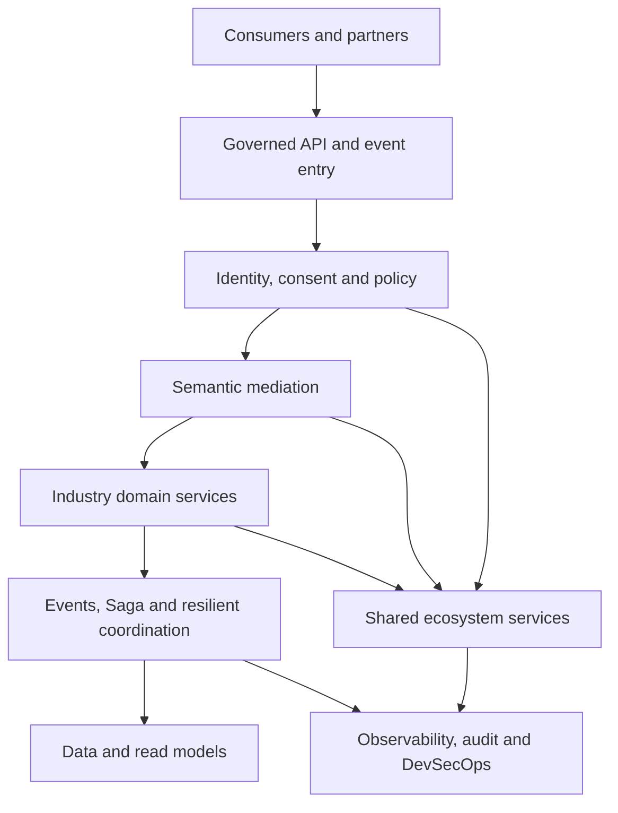

  

<h1 align="center">Open Industries</h1>

  Open, interoperable and auditable digital ecosystems powered by serverless microservices, shared standards and responsible AI-assisted architectural decisions.

  <a href="#research-abstract">Research</a> ·
  <a href="#open-industries-catalog">Industries</a> ·
  <a href="#reference-architecture">Architecture</a> ·
  <a href="#repository-standard">Repository standard</a> ·
  <a href="#contributing">Contributing</a>

---

## About Open Industries

**Open Industries** is an open-source research and engineering initiative that explores how organizations from different sectors can exchange data, coordinate distributed processes and reuse digital capabilities without becoming tightly coupled to a single platform, cloud provider or proprietary integration model.

The organization translates the doctoral research **“Adaptive AI-Assisted Orchestration and Semantic Interoperability Framework for Serverless Microservices in Hybrid Open Industry Ecosystems”** into reusable reference architectures, contracts, patterns, examples and validation assets.

Our goal is not to prescribe one universal implementation. We provide a common architectural foundation that can be adapted according to each industry's regulation, risk, latency, consistency, privacy and operational requirements.

### Mission

- Promote semantic, technical and organizational interoperability.
- Define provider-neutral patterns for serverless and event-driven systems.
- Reduce duplicated cross-cutting services across organizations and industries.
- Make architectural decisions observable, explainable and auditable.
- Provide reproducible examples based on open standards and synthetic data.
- Encourage responsible AI assistance under policy constraints and human oversight.

## Research abstract

Modern open ecosystems connect organizations, consumers, regulators, platforms and autonomous services through APIs and events. This openness accelerates innovation, but it also creates incompatibilities between data models, protocols, identities, security policies, regulatory obligations and service-level expectations. Serverless architectures improve elasticity and reduce infrastructure-management effort, yet they transfer complexity to distributed coordination, state management, eventual consistency, failure recovery and end-to-end observability.

The research proposes an adaptive framework for orchestration and semantic interoperability across serverless microservices operating in hybrid and multi-cloud environments. The framework combines governed API exposure, event-driven architecture, semantic mediation, reusable ecosystem services, distributed transaction patterns, observability and DevSecOps controls. Its core pattern set includes API Gateway, Saga, CQRS, Event Sourcing, Outbox/Inbox, idempotency, Circuit Breaker, Dead Letter Queue and backpressure mechanisms.

Interoperability is addressed at four complementary levels:

1. **Technical interoperability** — connectivity, protocols, runtime compatibility and transport.
2. **Syntactic interoperability** — explicit and versioned message, API and event schemas.
3. **Semantic interoperability** — preservation of meaning, context, units, purpose and provenance.
4. **Organizational interoperability** — alignment of responsibilities, policies, evidence and governance.

The framework uses OpenAPI, AsyncAPI, CloudEvents, Protocol Buffers, GraphQL schemas and OpenTelemetry to create portable contracts and observable execution flows. OAuth 2.0, OpenID Connect, Zero Trust, Policy as Code, software bills of materials and signed artifacts support identity, privacy, supply-chain security and verifiable governance.

AI is treated as an **architectural decision assistant**, not as an unrestricted autonomous authority. It may recommend routing, concurrency, scaling or coordination patterns using latency, error rate, backlog, cost and contextual signals. Every recommendation must remain bounded by policy, confidence thresholds, deterministic fallback, explanation, audit evidence and human approval for high-risk actions.

The reference framework was evaluated through controlled synthetic scenarios in Open Banking and Open Energy. The experiments demonstrated the feasibility of contract governance, idempotent processing, distributed compensation, adaptive scaling and correlated telemetry. Results indicate improved throughput, recovery and evidence coverage in distributed scenarios, while also confirming the latency and operational-complexity cost of remote coordination. These findings are research evidence from deterministic simulations and must not be interpreted as production benchmarks or regulatory certification.

### Resumen en español

Open Industries materializa una investigación doctoral orientada a resolver la coordinación e interoperabilidad semántica de microservicios serverless en ecosistemas híbridos. El marco integra contratos abiertos, APIs gobernadas, eventos, mediación semántica, servicios transversales, patrones de resiliencia, observabilidad y controles DevSecOps. La inteligencia artificial se utiliza únicamente como asistencia explicable para seleccionar rutas, patrones o parámetros, siempre bajo políticas, límites, auditoría y supervisión humana.

La validación utiliza escenarios sintéticos reproducibles de Open Banking y Open Energy. Los resultados respaldan la factibilidad técnica del enfoque y muestran mejoras en elasticidad, recuperación y trazabilidad, aunque también evidencian costos de latencia, consistencia eventual y complejidad operacional. Cada repositorio de esta organización adapta el marco a un dominio industrial específico sin presentar sus ejemplos como implementaciones productivas o certificaciones regulatorias.

## Reference architecture

### Architectural layers

| Layer | Responsibility |
|---|---|
| Exposure and entry | API Gateway, event ingress, quotas, routing and contract validation |
| Identity and consent | Authentication, authorization, purpose, consent and workload identity |
| Semantic mediation | Canonical vocabularies, mapping rules, schema evolution and provenance |
| Domain services | Independently deployable industry capabilities and local transactions |
| Events and orchestration | Broker, Saga, Outbox/Inbox, idempotency, CQRS, DLQ and backpressure |
| Data and persistence | Domain-owned state, event stores, read models and retention controls |
| Shared ecosystem services | Identity, audit, catalogs, configuration, notification and policy services |
| Observability and operations | OpenTelemetry, metrics, logs, traces, SLOs and incident evidence |
| DevSecOps and governance | CI/CD, IaC, GitOps, Policy as Code, SBOM, signing and compliance evidence |

## Open Industries catalog

The repositories are organized according to the industry domains identified by the research. Each repository applies the common framework while preserving its own actors, contracts, risks, events, regulatory context and quality priorities.

### 1. Open IT & AI

[**open-it-ai**](https://github.com/Open-Industries/open-it-ai) defines portable IT and governed AI services. It covers workload catalogs, model and service registration, explainable inference, policy-bound automation, platform observability and hybrid-cloud portability. The repository emphasizes model provenance, confidence, drift monitoring, access control and deterministic fallback.

### 2. Open Banking

[**open-banking**](https://github.com/Open-Industries/open-banking) focuses on consent-aware financial-data exchange and payment orchestration. Reference flows include payment authorization, account access, fraud or risk checks, fund reservation, confirmation and compensation. Idempotency, Saga, audit evidence, OAuth 2.0 and OpenID Connect are central requirements.

### 3. Open Healthcare & Insurance

[**open-healthcare-insurance**](https://github.com/Open-Industries/open-healthcare-insurance) explores secure exchange of clinical, eligibility, claims and insurance information. It prioritizes patient or policyholder consent, purpose limitation, data minimization, provenance, terminology mapping, confidentiality and auditable access.

### 4. Open Energy

[**open-energy**](https://github.com/Open-Industries/open-energy) addresses interoperable energy telemetry, grid services and event-intensive workloads. Typical patterns include partitioned event streams, backpressure, schema and unit normalization, time-series processing, anomaly events, DLQ handling and adaptive consumer scaling.

### 5. Open Manufacturing

[**open-manufacturing**](https://github.com/Open-Industries/open-manufacturing) supports production orders, equipment, quality, maintenance and supply-chain coordination. It connects operational and enterprise services through events while maintaining asset identity, traceability, safety boundaries and controlled compensation.

### 6. Open Agriculture

[**open-agriculture**](https://github.com/Open-Industries/open-agriculture) covers farm observations, sensors, crops, resources, traceability and smart-farming services. Semantic normalization is especially important for units, locations, varieties, environmental measurements and agricultural vocabularies.

### 7. Open Transportation & Logistics

[**open-transportation-logistics**](https://github.com/Open-Industries/open-transportation-logistics) models shipment, route, carrier, vehicle and delivery events across multiple parties. It emphasizes asynchronous status exchange, geospatial context, chain-of-custody evidence, exception management and resilient partner integration.

### 8. Open E-Commerce

[**open-ecommerce**](https://github.com/Open-Industries/open-ecommerce) coordinates orders, payment, inventory, fulfillment, delivery and customer notification. Saga and compensating actions are used to manage partial failures, while CQRS can support read-intensive catalog and order views.

### 9. Open Real Estate

[**open-real-estate**](https://github.com/Open-Industries/open-real-estate) provides patterns for property listings, transactions, documents, identity verification and service coordination. The domain requires provenance, controlled document access, reliable status transitions and interoperability among owners, buyers, agencies, financial institutions and authorities.

### 10. Open Media & Entertainment

[**open-media-entertainment**](https://github.com/Open-Industries/open-media-entertainment) addresses media assets, rights, metadata, publication, distribution and consumption events. It prioritizes rights-aware authorization, metadata interoperability, high-volume delivery signals and traceable content transformations.

### 11. Open Infrastructure & Construction

[**open-infrastructure-construction**](https://github.com/Open-Industries/open-infrastructure-construction) supports infrastructure assets, projects, permits, inspections, construction milestones and lifecycle evidence. The reference model promotes long-lived identifiers, document provenance, geospatial context and auditable multi-party workflows.

### 12. Open Education

[**open-education**](https://github.com/Open-Industries/open-education) focuses on portable learning records, credentials, courses, assessments and education services. Privacy, learner consent, credential verification and semantic compatibility between institutions are primary concerns.

### 13. Open Travel

[**open-travel**](https://github.com/Open-Industries/open-travel) coordinates travel, hospitality, availability, reservation, payment and disruption events. It uses versioned partner contracts, Saga compensation and event-driven notifications to handle multi-provider itineraries.

### 14. Open Government

[**open-government**](https://github.com/Open-Industries/open-government) models transparent and auditable digital public services. It covers citizen requests, cases, permits, benefits, notifications and inter-agency exchange while enforcing purpose, accessibility, records retention and accountability.

### 15. Open Eco

[**open-eco**](https://github.com/Open-Industries/open-eco) provides structures for environmental observations, sustainability indicators, emissions, resources and evidence. The domain emphasizes measurement provenance, unit normalization, data quality, transparent calculation and verifiable reporting.

### 16. Open Telecommunications

[**open-telecommunications**](https://github.com/Open-Industries/open-telecommunications) addresses network services, provisioning, assurance, incidents and partner integration. High event volumes, topology context, service-level objectives, fault isolation and near-real-time observability are central design drivers.

### 17. Open Pharmaceutical

[**open-pharmaceutical**](https://github.com/Open-Industries/open-pharmaceutical) supports pharmaceutical research, batches, quality, release and supply-chain traceability. It prioritizes controlled vocabularies, immutable evidence, separation of duties, provenance and strict access and retention controls.

### 18. Open E-Retail

[**open-eretail**](https://github.com/Open-Industries/open-eretail) specializes the commerce framework for product catalogs, retail orders, stores, inventory, promotions and omnichannel fulfillment. It combines synchronous customer interactions with asynchronous inventory and fulfillment events.

### 19. Open Automotive

[**open-automotive**](https://github.com/Open-Industries/open-automotive) covers vehicles, mobility, telemetry, service history, maintenance and ecosystem integration. It separates safety-critical boundaries from general digital services and requires strong identity, event provenance and lifecycle-aware contracts.

### 20. Open Legal Services

[**open-legal-services**](https://github.com/Open-Industries/open-legal-services) models legal matters, documents, evidence, workflow states and professional services. Confidentiality, legal privilege, immutable audit, access segregation, retention and explainable automation are mandatory design concerns.

### 21. Open Ecosystem Services

[**open-ecosystem-services**](https://github.com/Open-Industries/open-ecosystem-services) contains the reusable cross-industry foundation. It defines identity, consent, audit, API and event catalogs, semantic mediation, policy, configuration, notification, observability and error-management services that reduce duplication across every domain.

## Shared patterns

| Pattern | Primary use | Key control |
|---|---|---|
| API Gateway | Governed synchronous entry | Authentication, authorization, quotas and schema validation |
| Event-driven architecture | Temporal decoupling and variable demand | Schema governance, ordering and backpressure |
| Saga | Multi-service business transactions | Explicit state, timeout and compensating actions |
| CQRS | Different command and query requirements | Read-model freshness and consistency expectations |
| Event Sourcing | State history and replay | Schema evolution, storage growth and privacy controls |
| Outbox/Inbox | Reliable publication and consumption | Atomic persistence, deduplication and replay boundaries |
| Idempotency | Duplicate-safe commands and events | Stable keys, retention window and result reuse |
| Circuit Breaker | Failure containment | Thresholds, open interval and degraded response |
| Dead Letter Queue | Quarantine of unprocessable events | Classification, ownership and governed replay |
| Backpressure | Protection under overload | Lag, backlog, rate and downstream capacity |

## Open standards

- **OpenAPI** for synchronous REST contracts.
- **AsyncAPI** for asynchronous channels and operations.
- **CloudEvents** for portable event envelopes.
- **Protocol Buffers and gRPC** for typed internal communication.
- **GraphQL schemas** for governed aggregate queries.
- **OAuth 2.0 and OpenID Connect** for delegated identity flows.
- **OpenTelemetry** for portable metrics, logs and traces.
- **Kubernetes and OpenShift** for portable workload orchestration.
- **Infrastructure as Code and GitOps** for reproducible environments.
- **OPA/Rego** for policy-as-code examples.
- **SBOM and signed artifacts** for software-supply-chain evidence.

## Repository standard

Each industry repository follows a consistent structure:

| Path | Content |
|---|---|
| `.github/workflows/` | Continuous validation and security workflows |
| `contracts/` | OpenAPI, AsyncAPI and CloudEvents schemas |
| `docs/` | Architecture, domain model and ADRs |
| `examples/` | Synthetic requests, events and scenarios |
| `infrastructure/` | Kubernetes/OpenShift, Helm and environment assets |
| `observability/` | OpenTelemetry collectors, dashboards and alerts |
| `policies/` | Rego and other policy-as-code controls |
| `services/` | Domain and reusable microservices |
| `tests/` | Contract, integration, resilience, security and performance tests |

## Evidence and validation principles

All validation contributions should declare:

- architecture and version under test;
- synthetic or production-derived data classification;
- workload profile and duration;
- deterministic seed when applicable;
- latency percentiles, throughput and error rate;
- backlog, lag, retries, duplicates and compensations;
- trace, log and audit coverage;
- resource and cost assumptions;
- acceptance thresholds and known limitations.

Performance numbers must not be presented without their workload, environment and limitations. Synthetic results must always be labeled as synthetic. A successful experiment is not a regulatory certification, production-readiness assessment or guarantee of equivalent results in another environment.

## Responsible AI principles

AI-assisted components in this organization must:

1. operate within explicit policy and risk boundaries;
2. expose relevant inputs, recommendation and confidence;
3. preserve an auditable decision record;
4. provide deterministic fallback and rollback;
5. monitor drift, failure and unintended impact;
6. require human approval for high-risk decisions;
7. avoid using sensitive or regulated data without authorization;
8. never present generated evidence as real operational evidence.

## Contributing

Contributions are welcome from software architects, developers, platform engineers, security specialists, data professionals, researchers, industry experts and students.

Good first contributions include:

- improving domain vocabularies and semantic mappings;
- adding API or event contract examples;
- implementing provider-neutral reference services;
- creating OpenShift deployment overlays;
- adding contract, resilience or performance tests;
- contributing dashboards and SLO definitions;
- documenting architectural decisions and trade-offs;
- reviewing privacy, security or regulatory assumptions;
- reproducing synthetic experiments in a declared environment.

Before contributing, review the target repository's `CONTRIBUTING.md`, `SECURITY.md` and Code of Conduct. Never commit credentials, proprietary information, personal data, protected health information or regulated production records.

## Project status

The repositories are evolving research and reference implementations. They are intended for education, experimentation, architecture assessment and collaborative development. Unless a repository explicitly states otherwise, its contents are not production support commitments, certified implementations or legal advice.

## Research attribution

This initiative is derived from the doctoral research developed by **Heber Romero Tellez**:

> *Adaptive AI-Assisted Orchestration and Semantic Interoperability Framework for Serverless Microservices in Hybrid Open Industry Ecosystems* (2026).

When using research concepts, diagrams, validation results or substantial portions of the reference framework in academic work, provide appropriate attribution to the thesis and the corresponding repository version.

## License

Unless otherwise indicated in an individual repository, source code and documentation are released under the **Apache License 2.0**. Third-party specifications, trademarks and referenced standards remain the property of their respective owners.

---

  <strong>Open contracts. Shared meaning. Observable decisions. Interoperable industries.</strong>

## Contributors
- [@tec-girl](https://github.com/tec-girl) — fork maintainer
- [@psehgaft](https://github.com/psehgaft) — contributor
- [@san985tos](https://github.com/san985tos) — contributor
- [@frankjunker87-arch](https://github.com/frankjunker87-arch) — contributor
